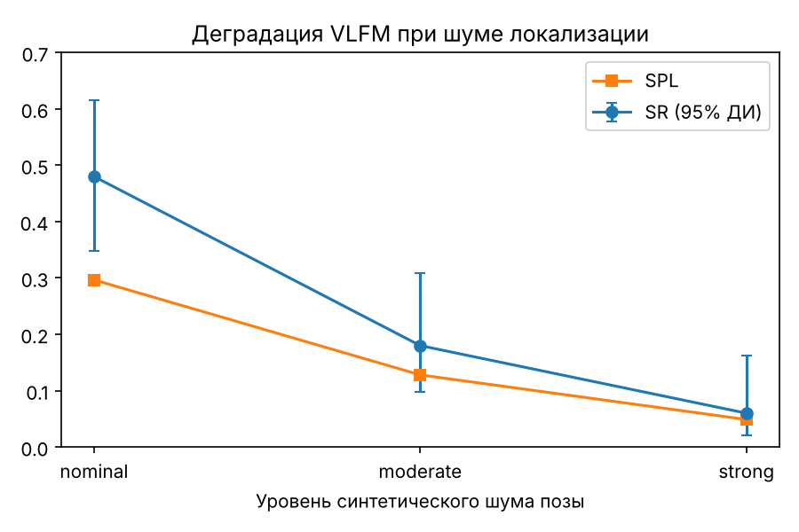

# VLFM ObjectNav: репликация, чувствительность к шуму локализации и модификация CAFS

*Репликация метода VLFM (Yokoyama et al., ICRA 2024) в Habitat на одной сцене MP3D. Версия отчёта: 10 ноября 2026 г.
Код: [rai-opensource/vlfm](https://github.com/rai-opensource/vlfm), commit `584ed56008754fde7997d904983607def8328322` + изменения из [`CHANGES.md`](../../CHANGES.md).
Все таблицы и рисунки генерируются командой `python scripts/make_tables.py` из CSV репозитория.*

## Аннотация

Конвейер VLFM развёрнут на RTX 5060 Ti (Habitat 0.2.4, PyTorch 2.8.0+cu128) и оценён на единственной доступной сцене MP3D
`17DRP5sb8fy` (split train, 50 эпизодов на запуск). VLFM показал SR 0.46–0.48 и SPL 0.28–0.30 в трёх независимых запусках.
Frontier-baseline, выбирающий ближайший frontier без семантики (Greedy), на тех же эпизодах дал SR 0.46 и SPL 0.28:
**значимой разницы с VLFM нет** (критерий Макнемара p = 1.0; ΔSPL Greedy−VLFM = −0.019, 95% бутстрап-интервал [−0.083; +0.052]).
Синтетический шум оценки позы резко ухудшает VLFM (SR 0.48 → 0.18 → 0.06), причём у неудач доминирует метка
`never_saw_target` (3 → 27 из 41), то есть шум нарушает обнаружение цели, а не выбор frontier. Модификация CAFS
(штраф за низкую локальную геометрическую уверенность) не помогла: без шума SR 0.48 → 0.40, ΔSPL −0.043 [−0.084; −0.013];
при умеренном шуме результат CAFS совпал с VLFM (9 из 50, те же 9 эпизодов).

**Чем это не является.** Это не оценка на validation-наборе HM3D/MP3D и не воспроизведение чисел статьи (HM3D val: SR 52.5, SPL 30.4).
Одна сцена и n = 50 дают доверительный интервал SR около ±0.13; выводы о методе в целом сделать нельзя.

## 1. Соответствие входному заданию

| Пункт задания | Статус | Где |
|---|---|---|
| 1. Развёртывание кода | выполнено | §3, `REPRODUCIBILITY.md` |
| 2. Базовый результат VLFM (SR, SPL, число неудач) | выполнено в сокращённом объёме: 50 эпизодов, одна сцена MP3D train вместо ≥100 эпизодов HM3D val; **среднее время шага не измерено** | §4–5 |
| 3. Сравнение с frontier-baseline | выполнено на тех же 50 эпизодах (Greedy и OracleFBE) | §5 |
| 4. Архитектура VLFM | выполнено | §2 |
| 5. Анализ отказов, ≥5 эпизодов | 11 эпизодов (6 у VLFM, 5 у CAFS) классифицированы по меткам логгера и ключевым кадрам; полный просмотр видео остаётся | §6 |
| 6. Устойчивость к шуму локализации, 3 режима | выполнено, один seed шума; малого уровня и разбора по компонентам нет (скрипт готов) | §7 |
| Исследовательская модификация | CAFS реализована и проверена; результат отрицательный | §8 |
| Предложение продолжения | §10 | §10 |

Причина сокращений: доступ к HM3D и остальным сценам MP3D (выдаётся Matterport по заявке) на момент работы не получен; для `val_mini`
файл эпизодов есть, но геометрии сцены `x8F5xyUWy9e` нет. В соответствии с заданием результаты не симулировались: невыполненное прямо помечено.

## 2. Архитектура VLFM

VLFM — zero-shot метод: собственная политика верхнего уровня не обучается. Метод собран из геометрических модулей и
предобученных моделей, связанных общей оценкой позы.

1. **Наблюдения и поза.** RGB, depth и оценка положения. В Habitat это сенсоры `gps` и `compass`;
   в `HabitatMixin._cache_observations` из них строятся `robot_xy`, `robot_heading` и преобразование камеры в эпизодическую систему координат.
2. **Карта препятствий.** Depth проецируется в облако точек и в двумерную сетку (свободно / занято / неизвестно).
3. **Frontier.** Границы между исследованной свободной областью и неизвестным пространством; кандидаты извлекаются из карты препятствий.
4. **Семантическая оценка.** BLIP-2 ITM сопоставляет RGB-кадр с запросом вида «Seems like there is a <объект> ahead»; это единственный источник семантики для выбора frontier.
5. **Value map.** Оценки ITM проецируются в карту ценности с весом уверенности, убывающим от центра поля зрения к краю; значения усредняются по наблюдениям.
6. **Выбор frontier.** Берётся frontier с наибольшей ценностью; в `ITMPolicyV2._get_best_frontier` есть удержание прежней цели (гистерезис) и `AcyclicEnforcer`, предотвращающие метания.
7. **Обнаружение цели** (отдельный контур): GroundingDINO (открытый словарь) и YOLOv7 (COCO) с масками MobileSAM; маска и depth дают положение объекта в карте. Как только цель обнаружена, она заменяет frontier как навигационная цель.
8. **Движение и остановка.** Предобученная PointNav-политика (`data/pointnav_weights.pth`; вход — depth и вектор до цели в полярных координатах) выдаёт дискретные действия; эпизод заканчивается STOP или лимитом шагов.

**Model-based:** построение карт из depth и позы, извлечение frontier, слияние оценок в value map, правило выбора. **Learning-based:** BLIP-2 ITM, GroundingDINO, YOLOv7, MobileSAM, PointNav.

**Предположение о локализации.** В Habitat `gps` и `compass` — точные данные симулятора. Все пространственные операции (проекция depth, размещение оценок ITM в value map, пересчёт цели в вектор для PointNav) считают эту позу истинной. В статье точность позы не анализируется; на реальном роботе она определяется одометрией и накапливает дрейф. Именно это предположение проверяет §7.

## 3. Среда и воспроизводимость

| Компонент | Версия |
|---|---|
| ОС | Ubuntu 22.04.5 в WSL2 |
| Python / PyTorch / NumPy / OpenCV | 3.9.23 / 2.8.0+cu128 / 1.26.4 / 4.5.5 |
| Habitat-Sim / habitat-lab / habitat-baselines | 0.2.4 / 0.2.420230405 / 0.2.420230405 |
| GPU | NVIDIA GeForce RTX 5060 Ti, 16 ГБ (compute capability 12.0) |

Окружение зафиксировано в `reports/reproduction/environment.yml` и `requirements-freeze.txt`. Изменения исходного кода — в
[`CHANGES.md`](../../CHANGES.md) и `source_changes.patch` (патч проверен: применяется к чистому commit без ошибок). Для совместимости с PyTorch ≥ 2.6
в `torch.load` задан `weights_only=False`; тайм-аут запросов к VLM-серверам увеличен с 1 до 30 с (это могло влиять на завершение медленных запросов).

Артефакты запусков (логи Hydra, tensorboard, видео, кадры, снимок конфигурации и версий) лежат в `reports/final_report/extra_materials/` и `reports/final_report/source_snapshot/`; контрольные суммы — `artifact_checksums.sha256`, `video_checksums.sha256`, `source_snapshot/model_checksums.sha256` (после правок документов пересоздаются `scripts/update_checksums.sh`). Патч `source_snapshot/source_changes.patch` — снимок от 22 октября и содержит только три правки совместимости; изменения для шума, Greedy и CAFS — в `source_changes.patch` в корне `reports/final_report/`.

GPU-рендеринг Habitat через EGL в WSL2 не заработал, все запуски выполнены с `gpu_device_id=-1` (программный рендеринг). Время шага в таком режиме
не отражает производительность на GPU и не измерялось.

**Про checkpoint.** У VLFM нет обученной верхнеуровневой политики: `dummy_policy.pth` (`should_load_ckpt=False`) — пустая заглушка, необходимая
фреймворку habitat-baselines. Реальные обученные веса (PointNav, ITM, детекторы, MobileSAM) загружаются; их отсутствие не ограничивает воспроизведение.

## 4. Данные и протокол

* Данные: MP3D ObjectNav, split train, сцена `17DRP5sb8fy`; для неё в файле эпизодов 50 000 эпизодов; на запуск взято 50 (`habitat.seed=100`, `shuffle=True`, `test_episode_count=50`).
  Метка train не означает утечки: VLFM на ObjectNav-эпизодах не обучается.
* Метрики: SR, SPL, SoftSPL, среднее конечное расстояние до цели, доля эпизодов с обнаруженной целью и вызванным STOP.
* Запуски: VLFM, основной (агрегаты; построчного лога нет); VLFM, диагностический повтор (построчно, **опорный прогон**);
  VLFM при нулевом шуме в серии шумовых прогонов (агрегаты) — третий независимый запуск; Greedy; CAFS; OracleFBE.
* Парность: для опорного прогона, Greedy и CAFS наборы из 50 ID совпадают (проверяется `make_tables.py`). Для основного прогона и OracleFBE ID не сохранены, их сравнения трактуются как сравнения независимых выборок.

## 5. Результаты

| Запуск | N | Успехи | Неудачи | SR [95% ДИ Уилсона] | SPL | SoftSPL | Ср. расст., м | Target detected | Stop called |
|---|---|---|---|---|---|---|---|---|---|
| VLFM, основной прогон (агрегаты из лога) | 50 | 23 | 27 | 0.46 [0.33; 0.60] | 0.2798 | 0.3699 | 2.18 | 0.78 | 0.78 |
| VLFM, повтор (опорный прогон, по эпизодам) | 50 | 24 | 26 | 0.48 [0.35; 0.61] | 0.2975 | 0.3820 | 2.08 | 0.76 | 0.76 |
| Greedy frontier (nearest), по эпизодам | 50 | 23 | 27 | 0.46 [0.33; 0.60] | 0.2786 | 0.3416 | 2.83 | 0.74 | 0.74 |
| CAFS (λ=0.15), по эпизодам | 50 | 20 | 30 | 0.40 [0.28; 0.54] | 0.2546 | 0.3310 | 2.53 | 0.72 | 0.70 |
| OracleFBE (агрегаты из лога) | 50 | 7 | 43 | 0.14 [0.07; 0.26] | 0.1028 | 0.2686 | 4.09 | 0.18 | 0.18 |

SPL/SoftSPL greedy и CAFS считаются по значениям, округлённым в исходных CSV до 2 знаков. Прогон из 5 эпизодов (SR 0.80) в сравнения не входит.

**Разброс между запусками VLFM.** Три запуска с одинаковым seed дали 23, 24 и 24 успеха (SR 0.46 / 0.48 / 0.48) и SPL 0.2798 / 0.2975 / 0.2966.
Различия в 1–2 эпизода и 0.02 по SPL — это шум прогонов (возможные источники: латентность VLM-серверов, недетерминизм GPU), а не эффект метода.

### 5.1. Парные сравнения (одни и те же 50 эпизодов)

| Сравнение (A против B) | Общих эп. | Только A успешен | Только B успешен | p (Макнемар, точный) | ΔSR (B−A) | ΔSPL (B−A) [95% бутстрап] | ΔSoftSPL (B−A) [95% бутстрап] |
|---|---|---|---|---|---|---|---|
| VLFM против Greedy frontier | 50 | 4 | 3 | 1.000 | -0.02 | -0.0189 [-0.083; +0.052] | -0.0404 [-0.107; +0.028] |
| VLFM против CAFS | 50 | 5 | 1 | 0.219 | -0.08 | -0.0429 [-0.084; -0.013] | -0.0510 [-0.093; -0.016] |

**VLFM и Greedy.** SR 0.48 против 0.46, в 4 эпизодах выиграл только VLFM, в 3 — только Greedy. На этой сцене семантическая оценка VLFM не даёт измеримого
преимущества над выбором ближайшего frontier; ΔSPL по модулю меньше разброса между запусками самого VLFM. Гипотезы (не проверены, нужны другие сцены): преимущество
проявляется в больших многокомнатных домах, где априори о расположении объектов важно; в сцене с небольшим числом комнат полный обход быстро находит цель;
ITM может быть плохо откалиброван для отдельных категорий. **Greedy** использует общие карту, детекторы и PointNav, поэтому он показывает вклад только стратегии выбора frontier, а не независимого геометрического агента.

**OracleFBE** берёт действие исследования из симуляторного сенсора `base_explorer` (пакет frontier_exploration), то есть исследует по информации симулятора, а не по собственной карте; это не тот baseline, о котором говорится в задании.

| Сравнение (независимые выборки) | Успехи A | Успехи B | p (Фишер) |
|---|---|---|---|
| VLFM, основной прогон (агрегаты из лога) против OracleFBE | 23/50 | 7/50 | 0.0009 |
| VLFM, повтор (опорный прогон, по эпизодам) против OracleFBE | 24/50 | 7/50 | 0.0004 |

Справедливо при допущении независимых выборок эпизодов (ID основного прогона и OracleFBE не сохранены).

В запуске OracleFBE цель обнаружена лишь в 18 % эпизодов, а 40 из 43 неудач имеют метку `never_saw_target`. При тех же детекторах это неожиданно мало; до проверки конфигурации
(длины путей, застревания, параметры вроде `allow_sliding`) разрыв с VLFM нельзя считать свойством метода. Основной вывод §5 опирается на сравнение с Greedy.

## 6. Анализ отказов

| Причина (метка логгера) | VLFM, без шума (повтор) | VLFM, умеренный шум | CAFS, умеренный шум | OracleFBE, без шума |
|---|---|---|---|---|
| bad_stop_true_positive | 3 | 0 | 0 | 0 |
| false_negative | 8 | 0 | 0 | 1 |
| false_positive | 12 | 14 | 12 | 2 |
| never_saw_target_did_not_travel_stairs_feasible | 3 | 27 | 29 | 40 |
| **успешных эпизодов** | 24 | 9 | 9 | 7 |
| **неудач всего** | 26 | 41 | 41 | 43 |

Умеренный шум: успехов VLFM 9, CAFS 9; общих успешных эпизодов 9; из успехов VLFM были успешны и без шума 7. Метки причин совпали у 39 из 41 общих неудач.

Метки присваивает логгер репозитория (`vlfm/utils/episode_stats_logger.py`) по эвристикам, это диагностические признаки, а не подтверждённые причины.
`false_positive` означает, что навигационная цель в момент остановки не попала в область целевого объекта; `never_saw_target_*` — цель не обнаружена за эпизод.
Замечание о возможной неточности: проверка выхода за границы карты в `was_false_positive()` ловит только `IndexError`, а отрицательный индекс NumPy
не вызывает ошибки и обращается к элементу с конца массива; часть меток `false_positive` могла быть присвоена неверно (метки можно пересчитать без перезапуска симулятора).

**Структура отказов VLFM без шума:** из 26 неудач 12 (46 %) — `false_positive`, 8 (31 %) — `false_negative`, по 3 — `bad_stop_true_positive` и `never_saw_target`.
Основная часть отказов приходится на проверку и локализацию цели и остановку, а не на исследование. У OracleFBE — наоборот (40 из 43 «цель не обнаружена»).

### 6.1. Разобранные эпизоды

| Эпизод | Цель | Запуск | Расст., м | Признаки | Метка логгера | Класс причины (гипотеза до просмотра видео) |
|---|---|---|---|---|---|---|
| 20409 | towel | VLFM | 8.54 | цель обнаружена, STOP | `false_positive` | остановка у неверного объекта или ошибка проекции маски на карту |
| 19572 | towel | VLFM | 0.1465 | цель обнаружена, STOP | `bad_stop_true_positive` | порог критерия success: оба успешных эпизода (34060, 44136) остановлены в 0.04 м; вероятен `success_distance` = 0.1 м (проверить в `vlfm_config.yaml`) |
| 37246 | counter | VLFM | 2.70 | цель не обнаружена, STOP нет | `false_negative` | пропуск цели детектором (категория плохо локализуется) или value map не привёл к объекту |
| 21514 | towel | VLFM | 3.87 | цель обнаружена, STOP | `false_positive` | по кадру 75 %: цель уже обнаружена, расстояние до истинной цели не уменьшается (3.66 → 3.87 м) — вероятна ошибочная привязка обнаружения (другой объект или смещение маски) |
| 25608 | shower | VLFM | 11.84 | цель не обнаружена, STOP нет | `false_negative` | по кадру 75 %: траектория ранее проходила рядом с областью цели на карте, но цель не обнаружена, к 75 % агент ушёл на 7.9 м; вероятен пропуск детектором (стеклянная перегородка душа) |
| 34380 | cabinet | VLFM | 0.75 | цель обнаружена, STOP | `false_positive` | по кадру 75 %: на карте три кандидата-шкафа, цель ещё не обнаружена; финальная остановка в 0.75 м — другой экземпляр или смещённая точка остановки |
| 17469 | table | CAFS | 7.23 | цель обнаружена, STOP | по флагам — как `false_positive` | CAFS изменила маршрут; остановка далеко от объекта |
| 26213 | shower | CAFS | 4.71 | цель не обнаружена, STOP нет | по флагам — «не увидел цель» | регрессия маршрута: baseline дошёл до цели в 0.03 м |
| 27356 | sink | CAFS | 2.69 | цель не обнаружена, STOP нет | по флагам — «не увидел цель» | регрессия маршрута |
| 35329 | cabinet | CAFS | 2.69 | цель не обнаружена, STOP нет | по флагам — «не увидел цель» | регрессия маршрута |
| 302 | bed | CAFS | 0.91 | цель обнаружена, STOP | по флагам — остановка вблизи | остановка слишком далеко от цели при успехе baseline (0.00 м) |

Видео, кадры на 25 / 50 / 75 % и логи запусков: `reports/final_report/extra_materials/{videos,frames,logs}` (эпизоды 19572, 21514, 25608, 34380, 37246 и успешные для сравнения 3966, 34060, 35329, 44136, 48617); для 20409 и 37246 дополнительно `reports/final_report/videos/`. Классы для 21514, 25608 и 34380 получены по ключевым кадрам (75 %), для остальных — по меткам и флагам; полный просмотр видео остаётся. Для эпизодов 17469 и 26213 просмотрены контактные листы по пяти кадрам (10–90 % длительности): общая структура карт и маршрутов схожа, различаются локальные наблюдения и конечные положения;
кадры не позволяют установить, какой frontier вызвал регрессию. **Требуется:** подтвердить классы по видео и по логам решений ранжировщика (в CAFS есть счётчик смен лидера, но нет лога выбора после гистерезиса).

**Замечание к эпизоду 37246.** В CAFS-прогоне он стал успешным при `target_detected = 0` и `stop_called = 0`. В стандартном Habitat ObjectNav успех требует вызова STOP, поэтому вероятная причина — особенность записи этих флагов
(они берутся из policy info на момент записи), а не свойство критерия. До проверки вывода из этого эпизода не делается.

## 7. Устойчивость к ошибкам локализации

**Где вносится шум.** В `HabitatMixin._cache_observations` подменяются `gps` и `compass`; через них проходят карта препятствий, value map, положение цели и вектор для PointNav. Симулятор движет агента по истинной динамике, критерий success и метрики считаются по истинной позе.

**Модель.** Независимый гауссов шум на каждом шаге по x, y и курсу плюс дрейф как случайное блуждание смещения (std за шаг); дрейф сбрасывается в начале эпизода; seed шума = базовый + номер эпизода, так что все политики получают одинаковые реализации. Курс моделируется отдельно: ошибка угла δψ смещает точку, наблюдаемую на расстоянии d, примерно на d·δψ, поэтому ошибка курса вредит карте сильнее позиционной. Уровни — синтетические стресс-сценарии, а не характеристики конкретного датчика.

| Уровень | σ xy, м | σ yaw, ° | дрейф xy, м/шаг | дрейф yaw, °/шаг | N | SR [95% ДИ] | SPL | SoftSPL | Ср. расст., м | Target detected | p (Фишер) к предыдущему |
|---|---|---|---|---|---|---|---|---|---|---|---|
| nominal | 0 | 0 | 0 | 0 | 50 | 0.48 [0.35; 0.61] | 0.2966 | 0.3811 | 2.0804 | 0.76 |  |
| moderate | 0.10 | 3.0 | 0.005 | 0.1 | 50 | 0.18 [0.10; 0.31] | 0.1280 | 0.2723 | 3.7303 | 0.42 | 0.0026 |
| strong | 0.25 | 8.0 | 0.015 | 0.3 | 50 | 0.06 [0.02; 0.16] | 0.0488 | 0.1676 | 4.4889 | 0.26 | 0.1212 |



SR падает с 0.48 до 0.18 (p = 0.003 по Фишеру) и до 0.06; различие между умеренным и сильным шумом при n = 50 не различимо (p = 0.12). Одновременно доля эпизодов с обнаруженной целью падает 0.76 → 0.42 → 0.26.

**Механизм (гипотеза).** При умеренном шуме у 27 из 41 неудачи VLFM (у CAFS 29 из 41) метка `never_saw_target`, без шума таких неудач 3. Правдоподобное объяснение: накопление объектной карты и подтверждение цели по нескольким кадрам нарушаются шумом позы, поэтому цель не регистрируется. Это объясняет и отрицательный результат §8: шум действует на объектную карту, а не на ранжирование frontier. Проверка требует разбора по компонентам (только курс, только позиция, белый шум против дрейфа) — для этого в `scripts/run_noise_experiment.sh` есть уровни `moderate_xy_only`, `moderate_yaw_only`, `moderate_white_only`, `moderate_drift_only` и `small`; они ещё не запускались.

**Ограничения.** Один seed шума; уровень «moderate» уже разрушает навигацию, малого уровня и порога деградации в данных нет; построчные результаты шумовых прогонов (кроме списков неудач) не сохранены, их ID не сверены.

## 8. Модификация CAFS

Confidence-Aware Frontier Scoring: `score = semantic_value − λ·(1 − confidence_local)`, λ = 0.15; `confidence_local` — среднее положительных значений карты уверенности value map в круге радиусом 0.5 м вокруг frontier. Это геометрическая уверенность по проекции depth, а не неопределённость позы и не неопределённость VLM. Значение λ задано заранее и не подбиралось. При реализации исправлен порядок координат ValueMap ((row, column), а не (x, y)).

**Гипотеза H1.** Frontier в плохо наблюдаемых областях ненадёжны; штраф за низкую локальную уверенность повышает SR и SPL. **H0:** эффекта нет. Предсказание: улучшение, более заметное при шуме.

**Результат: H1 не подтверждена.**
* Без шума (парно, 50 эпизодов): SR 0.48 → 0.40, ΔSPL −0.043 [−0.084; −0.013]; потери по success: 5, приобретения: 1 (знаковый тест p = 0.22 — по SR не значимо; по SPL интервал не включает ноль).
* При умеренном шуме: у VLFM и CAFS по 9 успехов из 50, это одни и те же 9 эпизодов; метки причин совпадают у 39 из 41 общих неудач. То есть CAFS при шуме не дала эффекта.
* В полном прогоне зарегистрировано 2663 смены лидирующего frontier на 8042 вызовах сортировки (≈33 %): если значения value map имеют порядок десятых долей, штраф до 0.15 сопоставим с их разбросом. Гипотеза причины отрицательного результата: масштаб штрафа не нормирован. Требует проверки (распределение значений value map; нормировка или мультипликативная форма) на отдельной tuning-выборке.

**Научная новизна и инженерная часть.** Подбор штрафа — инженерное улучшение; научный вклад был бы в формулировке «семантическая карта при неопределённой локализации» с оценкой неопределённости позы и критерием допустимости решений (§10). Здесь CAFS — проверка гипотезы о существовании эффекта.

## 9. Ограничения

1. Одна сцена, 50 эпизодов на запуск; доверительные интервалы SR порядка ±0.13.
2. Не validation-набор; не воспроизведение чисел статьи.
3. Для основного прогона VLFM, шумовых прогонов и OracleFBE нет построчных данных; парность подтверждена только для опорного прогона, Greedy и CAFS.
4. Greedy не независим от VLFM по архитектуре; OracleFBE исследует по информации симулятора и работает аномально (18 % обнаружений).
5. Разброс между запусками VLFM порядка 1–2 эпизодов, причина не установлена.
6. Программный рендеринг в WSL2; время шага не измерено (требование задания не выполнено).
7. Шум синтетический, один seed, нет малого уровня и разбора по компонентам.
8. Метки отказов — эвристики; возможна неточность в `was_false_positive()` (§6); классы причин в §6.1 — гипотезы до просмотра видео.
9. Увеличенный тайм-аут VLM-серверов мог повлиять на завершение медленных запросов.

## 10. Предложение исследовательского продолжения

**Тема.** Навигация по семантической карте при неопределённой локализации: как сохранить работоспособность метода класса VLFM при ошибках позы и обеспечить, чтобы решения (регистрация цели, выбор frontier, STOP) принимались только при достаточной достоверности позы.

**Мотивация из данных.** При умеренном шуме SR падает с 0.48 до 0.18, а доля неудач «цель не обнаружена» растёт с 3 до 27 из 41; CAFS, меняющая только ранжирование frontier, не помогает. Узкое место — накопление объектной карты, а не выбор frontier.

**Предлагаемый подход.**
1. *Картографирование с учётом неопределённости:* вес наблюдения обратно пропорционален ковариации позы; объектные гипотезы накапливаются в системе координат с неопределённостью, а не по точечным проекциям.
2. *Монитор целостности по аналогии с RAIM/FDE:* проверка невязок фильтра (критерий χ²) для обнаружения скачков и отказов локализации; protection level — граница ошибки позы с заданной вероятностью. Регистрация цели и STOP допускаются, если protection level меньше допуска критерия успеха; иначе — безопасное поведение (повторное наблюдение, возврат к хорошо локализованному участку).
3. *Информационная ценность frontier:* ожидаемый прирост информации о цели минус цена неопределённости и пути; активная локализация (плановый возврат к опорным местам).

**Гипотезы.** H1: взвешивание по неопределённости снижает долю `false_positive` при дрейфе; H2: монитор целостности уменьшает число ложных остановок ценой роста длины пути; H3: информационный критерий лучше штрафа за расстояние при большом дрейфе и не хуже без шума.

**Эксперименты.** Модели ошибок: белый шум, дрейф, скачки и выбросы; несколько уровней и ≥3 seed шума; сравнение VLFM, Greedy и предложенного метода на фиксированных эпизодах HM3D и MP3D (после получения доступа); метрики SR, SPL, SoftSPL, ложные остановки, метрики целостности (доля нарушений protection level, вероятности ложной тревоги и пропуска отказа), время вычислений.

**Humanoid.** Нужна поза камеры в SE(3) с кинематикой тела (качка, тангаж при ходьбе, неопределённость контакта стопы), сенсоры IMU и одометрия по ногам; монитор целостности должен учитывать модель походки.

**Новизна и риски.** Новизна — переносимая формализация целостности для семантических карт (границы ошибки, условия неизбежной деградации, обнаружение отказа), а не подбор штрафов. Риски: нехватка сцен, низкая статистическая мощность при малом числе эпизодов, зависимость от качества оценки ковариации позы.

## 11. Выводы

1. Конвейер VLFM воспроизводится в Habitat на RTX 5060 Ti; на одной сцене SR 0.46–0.48, SPL 0.28–0.30; разброс между запусками 1–2 эпизода.
2. На этой сцене VLFM не отличим от выбора ближайшего frontier без семантики (p = 1.0); о преимуществе метода в целом это не говорит и не опровергает его.
3. Ошибки позы разрушают работу системы (SR 0.48 → 0.18 → 0.06), главным образом через обнаружение цели.
4. CAFS не улучшила результаты ни без шума, ни при шуме; гипотеза о роли масштаба штрафа подлежит проверке.
5. Не выполнено: ≥100 эпизодов HM3D val, время шага, малые уровни шума и разбор по компонентам, повторы по seed, подтверждение отказов по видео.

## Приложение. Воспроизведение таблиц

```bash
python scripts/make_tables.py            # все таблицы и рисунки -> reports/final_report/tables/
bash scripts/run_noise_experiment.sh moderate vlfm 50   # построчные данные шума; make_tables подхватывает reports/noise/*/episodes.csv
```
